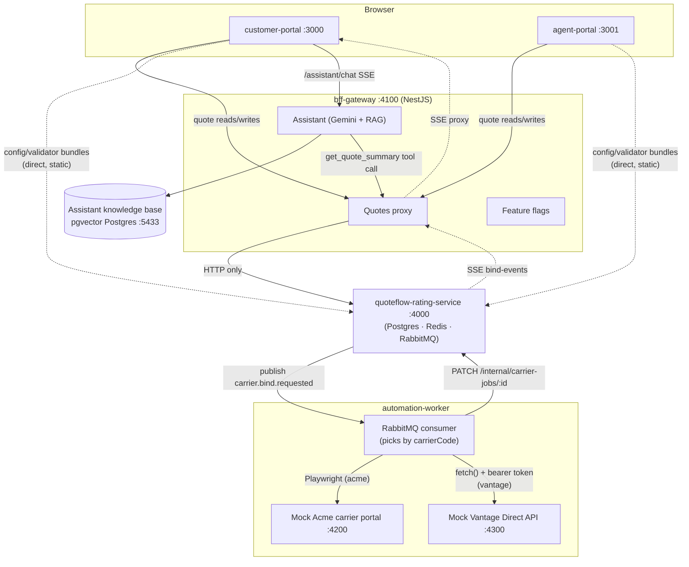

# quoteflow-apps

The frontend/orchestration monorepo for **QuoteFlow** — a portfolio-quality sample built around
two fictional carriers, **Acme Insurance** and **Vantage Direct**. This repo owns no quote
data of its own: it renders the customer- and agent-facing auto insurance quote flow, and
every quote read/write is proxied over HTTP to a separate service,
[`quoteflow-rating-service`](../quoteflow-rating-service) (Repo 1) — never a shared database
connection.

> Status: complete (all 12 build milestones) — both portals, the BFF, an
> RabbitMQ-consuming automation worker, six shared libs, a Gemini-powered assistant with RAG +
> tool calling, feature flags, and OpenTelemetry.

## What this demonstrates

1. **A clean HTTP-only boundary between two independently deployable systems.** `bff-gateway`
   is the *only* thing either portal talks to for quote data; it proxies to
   `quoteflow-rating-service` and otherwise owns nothing durable of its own except a local
   feature-flag file and (for the assistant) a knowledge base that isn't quote data.
2. **Real shared-library reuse across two apps that need to diverge in exactly one place.**
   `customer-portal` and `agent-portal` render the *same* config-driven quote form from the
   *same* libs — the only difference between them is which `portal` value they pass to
   Repo 1's config resolver, which changes field visibility (e.g. agents don't see the
   customer's phone field) without a single line of portal-specific page code. See
   [Milestone 7](#milestones) below.
3. **An async hand-off across the process boundary via RabbitMQ**, not a synchronous call, to
   *two different bind mechanisms picked per carrier*: binding a policy means Repo 1 publishes
   a job and returns immediately; a worker in *this* repo consumes it and either drives a mock
   carrier portal with Playwright (Acme — no API to call instead) or calls a mock carrier REST
   API directly (Vantage Direct), then reports progress back over a second,
   server-to-server-only HTTP call. See [The RabbitMQ hand-off](#the-rabbitmq-hand-off-bind-flow).
4. **A RAG + tool-calling assistant that's actually grounded**, not just prompt-stuffed: a
   dedicated pgvector store for coverage-explainer docs, real cosine-similarity retrieval, and
   a live Gemini function call that reads the customer's own in-progress quote.

## Architecture



## Apps

| App | Port | What it is |
|---|---|---|
| `customer-portal` | `:3000` | Next.js App Router. SSR for the pre-quote landing page, CSR once a `quoteId` exists (sessionStorage-backed). Floating assistant chat widget on `/quote`. |
| `agent-portal` | `:3001` | Same libs, same `/quote` page shape as customer-portal — the only difference is `portal: 'agent'` passed to `useCarrierRouteConfig()`, which applies Repo 1's agent override chain (currently: hides the phone field). |
| `bff-gateway` | `:4100` | NestJS. The only thing either portal talks to for quotes/flags/the assistant. Proxies quote reads/writes to Repo 1, evaluates feature flags from a local JSON file, and runs the Gemini-powered assistant. |
| `automation-worker` | n/a (worker) + `:4200`/`:4300` (mocks) | Consumes `carrier.bind.requested` from RabbitMQ and binds via one of two mechanisms picked per job's `carrierCode`: Acme drives a bare Express + server-rendered "carrier portal" via Playwright (`:4200`); Vantage Direct calls a bare Express JSON API directly (`:4300`, bearer-token auth). Either way: retries with backoff, dead-letters after N attempts, reports progress back to Repo 1. Ships a `dlq` CLI (`depth`/`list`/`replay`/`purge`). |

## Libs

| Lib | Owns |
|---|---|
| `ui-components` | Radix/shadcn-style atoms/molecules/organisms (atomic design), documented in Storybook. |
| `state` | Client-side React hooks: `useQuoteSession` (sessionStorage-backed, read/write-through to bff-gateway) and `useChatStream` (parses the assistant's SSE stream). Both backed by module-level Zustand stores rather than `useState`, so a long-running async function can read the latest state via `.getState()` without a stale-closure bug. |
| `api-client` | A typed `Result<T, E>` HTTP client for Repo 1/bff-gateway — never throws, callers branch on `result.success`. |
| `form-renderer` | Config-driven form rendering (`<ConfigDrivenPage>`) plus the two "load compiled code from Repo 1's bundle manifest" patterns: `resolveCarrierRouteConfig()` (Pattern 1: config) and the validator loader (Pattern 2: field validators), both via a generic cached dynamic-`import()` module loader. |
| `feature-flags` | OpenFeature-style: a `FeatureFlagClient` facade over a swappable `FeatureFlagProvider`. Ships a local-JSON-file provider (the default here) and a stubbed LaunchDarkly-shaped provider — swapping providers never touches a call site. |
| `ai-assistant` | Server-only (consumed by bff-gateway alone): a Gemini client wrapper (chat streaming + embeddings), a pgvector-backed knowledge store, and a chat-service orchestrator doing RAG retrieval + tool-calling. |

## Requirements

- Node.js 20+ (developed against Node 24).
- [`quoteflow-rating-service`](../quoteflow-rating-service) running on `:4000` — start that
  repo first; its own README covers its Postgres/Redis/RabbitMQ containers.
- A second, dedicated Postgres for the assistant's knowledge base (pgvector extension) — **not**
  the same instance as Repo 1's:
  ```bash
  docker run -d --name quoteflow-assistant-postgres -p 5433:5432 \
    -e POSTGRES_PASSWORD=quoteflow -e POSTGRES_DB=quoteflow_assistant pgvector/pgvector:pg16
  ```
- Your own [Gemini API key](https://aistudio.google.com/apikey) if you want the assistant
  working — everything else in this repo runs without one.

## Setup

```bash
npm install
npx playwright install chromium   # needed once, for automation-worker's mock-portal driver

# bff-gateway
cp apps/bff-gateway/.env.example apps/bff-gateway/.env
# fill in GEMINI_API_KEY (skip if you don't need the assistant — everything else still works)
npm run seed:assistant --prefix apps/bff-gateway   # embeds the 6 static coverage docs into pgvector

# automation-worker
cp apps/automation-worker/.env.example apps/automation-worker/.env

npm run dev:customer-portal    # :3000
npm run dev:agent-portal       # :3001
npm run dev:bff-gateway        # :4100
npm run dev:automation-worker  # RabbitMQ consumer + mock Acme portal (:4200) + mock Vantage API (:4300)
npm run storybook              # :4400, ui-components' component catalog
```

Each app also has its own `.env.example` documenting exactly which vars are required vs.
optional and why — start there before asking "what do I need to set."

## The RabbitMQ hand-off (bind flow)

Binding a policy is the one place this system is genuinely asynchronous, not a chain of
synchronous HTTP calls:

1. The browser calls `bff-gateway`'s quote proxy, which calls Repo 1's `POST /quotes/:id/bind`.
2. Repo 1 creates a `carrier_jobs` row, publishes `carrier.bind.requested` to RabbitMQ, and
   returns **immediately** (`202 Accepted`) — it does not wait for the bind to finish.
3. `automation-worker` (this repo), a completely separate process with no HTTP route the
   browser ever calls directly, consumes that message and picks a bind mechanism by the job's
   `carrierCode` (`src/worker/bind-job-handler.ts`'s `API_DRIVEN_CARRIER_CODES`): for Acme, it
   launches Playwright and drives a mock carrier portal (`src/mock-carrier-portal` — a bare
   Express app, deliberately not a React SPA, the way automation against a *real* carrier
   portal would have to log in and fill an HTML form); for Vantage Direct, it makes one
   authenticated `fetch()` call to a mock carrier REST API (`src/mock-carrier-api` — bearer
   token, no browser involved at all). Both paths converge on the same `{ policyNumber }`
   result shape, so everything downstream doesn't care which one ran.
4. On success or exhausted retries, the worker calls back `PATCH /internal/carrier-jobs/:jobId`
   on Repo 1 — a server-to-server-only route with no CORS, guarded by a regression test on
   Repo 1's middleware ordering (see that repo's CLAUDE.md).
5. Repo 1 pushes the status change over Server-Sent Events; `bff-gateway` proxies that SSE
   stream verbatim; the browser's `useQuoteSession` polls/subscribes and shows it live.

Both the main queue and its dead-letter queue are declared with **identical arguments on both
sides** (Repo 1's producer and this repo's consumer) — RabbitMQ requires that, and it means
either service can boot first without a `PRECONDITION_FAILED` error. A failed bind job retries
with exponential backoff (1s/2s/4s.../10s cap) before landing in the DLQ; `npm run dlq --prefix
apps/automation-worker -- list` inspects it non-destructively, `-- replay <n>` puts jobs back on
the main queue with a reset retry count.

**Scope note:** `customer-portal`/`agent-portal` currently only ever call `POST /quotes` with
`carrierCode: 'acme'` (see `lib/config.ts`'s `CARRIER_CODE`) — there's no carrier picker UI.
Vantage Direct's whole quote → bind lifecycle is real and fully wired (verified live via direct
API calls against Repo 1 and this repo's worker), it's just not reachable by clicking through
either portal yet. Adding a picker is a small, self-contained UI change; the backend and worker
need nothing further.

## Scripts

| Script | What it does |
|---|---|
| `npm run dev:customer-portal` / `dev:agent-portal` / `dev:bff-gateway` / `dev:automation-worker` | starts that app in watch mode |
| `npm run storybook` | ui-components' Storybook on `:4400` |
| `npx nx run-many -t typecheck lint test -p <project>` | the standard check sequence this repo's commits are verified against |
| `npx nx sync` | updates TypeScript project references after adding a new cross-lib import (Nx will tell you when this is needed) |
| `npm run seed:assistant --prefix apps/bff-gateway` | embeds the static coverage docs into the assistant's pgvector store (safe to re-run) |
| `npm run dlq --prefix apps/automation-worker -- <depth\|list\|replay\|purge>` | inspect/recover the bind-job dead-letter queue |

## Design notes

- [docs/adr/0002-legacy-apm-agent-to-opentelemetry.md](./docs/adr/0002-legacy-apm-agent-to-opentelemetry.md) —
  why bff-gateway's tracing setup exists and the one thing (PII redaction) it deliberately
  doesn't try to replicate from a (fictional, for narrative purposes) predecessor.
- [CLAUDE.md](./CLAUDE.md) — the real architecture summary an agent (or a new contributor)
  should read before touching this repo, including the two rules everything else depends on
  (bff-gateway proxies, never touches quote data directly; the assistant's Postgres is separate
  from Repo 1's).

## Relationship to `quoteflow-rating-service`

Run that repo first — this one assumes it's already up on `:4000`. The two repos are separate
git histories, separate `npm install`s, and talk **only over HTTP**: no shared database, no
shared types package (the response shapes are deliberately duplicated in `libs/api-client`,
each repo owning its own view of the contract). The one exception to "HTTP only" is
conceptual, not a shared connection: both `quoteflow-rating-service`'s RabbitMQ producer and
this repo's `automation-worker` consumer declare the exact same queue/exchange topology,
because RabbitMQ requires it — see [The RabbitMQ hand-off](#the-rabbitmq-hand-off-bind-flow).
